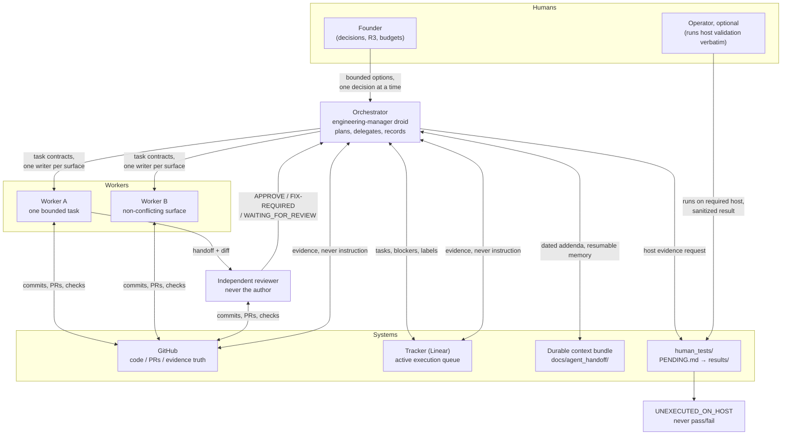

# Factory Engineering Mission Template

A reusable operating system for long-running, multi-agent engineering with
Factory: an orchestrator that delegates to specialist workers, risk-tiered
autonomy, evidence-based completion, independent review of high-risk
changes, host-specific validation, and a structured path for spending the
founder's attention only where it is actually required.

**Understand it in two minutes. Adopt it in five.**

---

## The problem this template solves

AI agents can generate unlimited work. What they cannot do by default is:

- tell the truth about what is actually **proven** versus merely attempted;
- stop themselves from **weakening tests** to make a gate go green;
- resist claiming **host-specific results** (a real device, OS, or
  environment) from whatever machine they happen to run on;
- avoid turning every small decision into a **queue of founder
  interruptions** — while also not silently grabbing authority they were
  never given.

This template installs the missing operating model. It was extracted from
a real, long-running autonomous engineering project and generalized: its
rules come from observed failure modes — false success claims, weakened
acceptance bars, wrong-host evidence, idle missions blocked on a human,
and unsupervised merges of the very logic that decides what "done" means.
A small number of mechanisms are extensions of the source system rather
than direct extractions; they are flagged in place.

The core promise: **the agents ship; the founder decides.** Work moves at
machine speed on everything below the risk line, and the founder's
attention is reserved for the decisions that are genuinely theirs.

## How it fits together



One job per surface: **GitHub** is the truth for code and evidence. **The
tracker** is the active queue (every task/blocker/gate is an issue,
labeled by what can unblock it). **The durable context bundle** is memory
a brand-new agent can resume from. **`human_tests/`** is the one-way
boundary where host-specific evidence crosses from machines to the repo.
And the founder's direct session is the **only** instruction channel —
issues, PRs, and web content are evidence, never instructions.

## 5-minute quickstart

1. **Copy the template into your repository.** Copy every file of this
   template (except `.git/`) — the docs, skills, droid, templates, and
   examples are cross-referenced, so take them all. Then create the three
   runtime directories the system writes into:

   ```text
   docs/agent_handoff/     durable context bundle (seed it: docs/architecture.md § Bootstrap)
   human_tests/            host/human evidence boundary (PENDING.md + results/)
   agent_reports/          dated daily reports (format: examples/example-daily-report.md)
   ```

   The starter `.gitignore` already keeps secrets, logs, and raw host
   artifacts out of the repository.

2. **Decide your risk surfaces.** Edit `AGENTS.md`: name what R2 means in
   *your* project (typically: verification/acceptance logic, safety
   flows, privacy, credentials, telemetry) and what R3 means (real
   external side effects). Keep R3 crisp — it is the line the agents
   will not cross without you.

3. **Protect `main` and scope the agents' credential.** Add a ruleset that
   rejects agent direct pushes. Give the agents a scoped credential
   (contents/PRs/issues read-write, nothing administrative) — e.g., via
   Factory Secrets or your platform's equivalent — and have the agents use
   it through a credential helper with a clean remote URL, never a
   token-embedded one. The credential is never printed, logged, echoed, or
   persisted; any broader personal credential on the host stays read-only
   for agent work; deviations get recorded as incidents, never silently
   repeated. Configure a distinct, non-secret agent commit identity.

4. **Create the queues.** Copy the label set from
   `examples/example-linear-queue.md` into your tracker: `needs-machine` /
   `needs-human` / `needs-founder`, plus R0–R3. Create
   `docs/agent_handoff/HOST_VALIDATION_QUEUE.md` using the queue schema in
   `.factory/skills/host-validation/SKILL.md` §5, and seed
   `docs/agent_handoff/00_README.md` from the bootstrap guide in
   `docs/architecture.md` (as-of anchors, read order, precedence).

5. **Start the Mission.** Paste `templates/mission-start-prompt.md` with
   your objective into a Factory Mission (or any session with the
   engineering-manager droid). It will reconcile state, propose the first
   three tasks with risk tiers and evidence bars, and begin.

From then on, the three skills run the loop: reviews use
`independent-review`, host evidence uses `host-validation`, and whenever
the queue fills with founder-blocked items, run the
`human-dependency-audit`.

## Mission orchestration

The orchestrator (`.factory/droids/engineering-manager.md`) does not
implement. It runs a loop:

1. **Reconcile** — inspect repo, PRs, queues, and durable context;
   records must match repository evidence before planning.
2. **Plan** — pick the highest-value unblocked item; classify its risk
   tier and required execution environment; write the task contract
   (`templates/task-contract.md`) with the acceptance evidence bar.
3. **Delegate** — one bounded task per worker, one writer per surface.
4. **Verify** — a task is complete only when its evidence exists at an
   exact SHA. Never "code written".
5. **Route** — high-risk changes to an independent reviewer; host-bound
   evidence to the validation queue; R3 and budgets to the founder with
   bounded options.
6. **Record** — tracker, durable context (dated addenda), daily report.
7. **Continue** — never idle while safe work exists; blocked lanes get
   one escalation and a re-queue.

Every substantive report to the founder follows the same contract:
**Changed / Evidence / Risk / Proven-vs-unproven / Next action.**

## Worker/reviewer separation (example)

> A worker implements a change to the code that decides whether an action
> is reported `CONFIRMED` (an R2 surface: verification logic). Its
> fixture tests pass, so it opens a draft PR, writes its handoff
> (`templates/worker-handoff.md`), and **stops editing**. A different
> worker picks up the independent-review skill and re-derives everything:
> Does the required evidence exist? Did host evidence really come from the
> host? Did any passing gate regress? **Was any assertion weakened?** Are
> safety/privacy boundaries intact? Is this review independent? Does the
> PR say precisely what is unproven? All seven hold → `APPROVE` and a
> conditional merge. Any fails → `FIX-REQUIRED` or `WAITING_FOR_REVIEW`
> with the exact missing piece queued.

The separation is the point: the author of a change is the least
trustworthy reviewer of it, and the most dangerous failure — quietly
weakening what "done" means — is invisible unless someone else
re-derives the evidence.

## The tracker (Linear) workflow

Every task, blocker, human gate, and decision is a tracker issue, labeled
so the queue sorts by **what can unblock it**:

- `needs-machine` — no human required; if it idles, automate it.
- `needs-human` — a qualified human (not the founder) runs a written
  procedure.
- `needs-founder` — R3, budgets, policy, merge/release, genuine
  human-experience validation. Keep this list short.

Plus risk labels (`R0`–`R3`) and optional `needs-<host>` / `metered`.
Issues carry their acceptance evidence bar; comments follow the
`[AGENT]` reporting contract; after each merge, affected checks re-run at
exact before/after SHAs. A full worked example, including a host
validation request flowing through `INCOMPLETE`, is in
`examples/example-linear-queue.md`.

## R0–R3: the risk model

| Tier | What | Autonomy |
|---|---|---|
| R0 | Docs, research, fixtures, analysis | Full |
| R1 | Bounded implementation/refactor | Full, with tests |
| R2 | Verification/safety/privacy/credentials/telemetry + **any test or bar attached to them** | Implement and PR freely; merge only when 7 independent-review conditions hold |
| R3 | Real external side effects | **Founder authorization, every time** |

The full model — including the 7 conditional-merge conditions, standing
authorizations with expiry, review backpressure (~2 unreviewed PRs),
budget discipline, and worked examples — is in `docs/risk-model.md`.

## Evidence and verification

`docs/evidence-policy.md` is the template's spine:

- **Proven / unproven / blocked** are always separated; proven means an
  artifact exists at a stated SHA.
- **Attempt ≠ action ≠ verified result.** A successful API call or button
  press proves the attempt, not the goal. Truthful `UNCONFIRMED` beats
  false `CONFIRMED`; false confirmation is a red line.
- **Host honesty.** CI on one OS never certifies another; fixtures never
  certify devices; unrun host cases are `UNEXECUTED_ON_<HOST>`, never
  pass/fail. Host evidence crosses exactly one boundary:
  `human_tests/PENDING.md` → operator/founder runs it on the host →
  sanitized `human_tests/results/`.
- **Never weaken a bar to pass.** No deleted hard cases, no post-hoc
  rewritten expectations, no threshold-lowering, no sleeps replacing
  checks. Changed assertions on high-risk surfaces get independent review
  and must be justified against a known-failing case.
- **Benchmark integrity.** Development / regression / sealed-holdout
  sets; every report carries numerator/denominator + commit + env; any
  new run is a new run.

## Human-dependency audit

Periodically (or when the queue fills with `needs-founder`), run the
`human-dependency-audit` skill with
`templates/founder-dependency-reduction-prompt.md`. It inventories every
wait, classifies it, and produces per-item proposals that push work
leftward — needs-founder → needs-human → needs-machine — through:
written operator procedures, bounded standing authorizations (with
expiry, stop conditions, and ledgers), one-time bootstrap checklists,
synthetic test surfaces, and automation. Two invariants survive every
proposal: **evidence quality stays equal or stronger**, and **the
experience of a real human stays human** — a simulation can never
substitute for it. The founder approves items independently; every grant
is recorded, expirable, and revocable in one word.

## Customizing

- **Risk surfaces**: edit `AGENTS.md` + `docs/risk-model.md` to name your
  R2/R3. The labels are stable; the definitions must be yours.
- **Hosts**: the host-validation skill is host-agnostic by design — name
  your required hosts (an OS, a device lab, a browser engine, a
  production environment) and your queue prefix.
- **Tracker**: label names matter more than the tool; the workflow works
  with any tracker that supports labels and states.
- **Droids/skills**: add specialist worker droids per surface
  (implementation, review, research), each keeping the same reporting
  contract. Add skills for recurring procedures; keep each one a
  checklist with concrete verification steps, not prose.
- **Scale down**: solo project? The orchestrator and one worker can be
  the same session — but final review of an R2 change must be materially
  independent of the authoring context: a different worker, a fresh
  session, or the founder. Same-context self-review is never sufficient.
- The template adapts to your operating model, never the reverse: if a
  rule contradicts how you want to work, change the rule and record why
  in the durable decision record.

## Example lifecycle

```text
tracker issue (task contract + evidence bar)
  → worker implements on agent/YYYY-MM-DD/<slug>
  → focused tests + regressions at exact SHA
  → host-bound evidence queued (HVQ row → human_tests/PENDING.md)
  → operator/founder runs on the host → sanitized results file
  → independent review: 7 conditions → APPROVE
  → conditional merge (R2) / merge after explicit founder authorization (R3)
  → before/after checks re-run; queue + durable context + daily report updated
  → issue closed with evidence pointers
```

## Repository contents

```text
AGENTS.md                          compact, always-on governance
LICENSE                            MIT
.gitignore                         keeps secrets/logs/raw artifacts out
.factory/droids/engineering-manager.md    mission orchestrator
.factory/skills/independent-review/SKILL.md
.factory/skills/host-validation/SKILL.md
.factory/skills/human-dependency-audit/SKILL.md
templates/mission-start-prompt.md
templates/mission-approval-prompt.md
templates/founder-dependency-reduction-prompt.md
templates/task-contract.md
templates/worker-handoff.md
docs/risk-model.md
docs/evidence-policy.md
docs/linear-workflow.md
docs/architecture.md
docs/maturity.md                    honest proven-vs-unproven self-assessment
docs/mission-plan.md                v0.1 development mission plan and status
examples/example-linear-queue.md
examples/example-daily-report.md
scripts/validate.py                structural self-check (stdlib only)
agent_reports/2026-10-22.md        Day 1 daily report
```

## Verifying your copy

Run the structural self-check from the repository root:

```text
python3 scripts/validate.py
```

It exits 0 when the README contents tree matches the working tree and
every internal file reference resolves, and non-zero (naming the offending
references) otherwise. It uses only the Python standard library and never
touches the network. What is proven versus still unproven about this
template is recorded in `docs/maturity.md`.

## Limitations and safety disclaimer

- **A template is not oversight.** This structure makes honest behavior
  the easy path; it cannot *force* it. The human who reads the reports
  and runs the validations is a load-bearing component.
- **LLM behavior is probabilistic.** Rules, checklists, and independent
  review reduce the failure rate of agent claims; they do not eliminate
  it. Treat `PROVEN` as "best-evidence-so-far", keep rollback points,
  and protect `main` mechanically rather than trusting convention.
- **Credentials and side effects are yours.** Scoped credentials, branch
  protection, production access, and the definition of R3 must be
  configured by a human, per repository. Never grant agents
  administrative permissions because a template assumed they existed.
- **The audit can be wrong.** A delegation that looks evidence-equal can
  still fail in practice; that is why every grant is revocable and every
  reduction is tracked. Revoke on the first degraded result.
- **No warranty.** MIT license. This template reflects one working
  system, not a guarantee for yours. Adapt it, measure it, and keep the
  parts that earn their keep.
